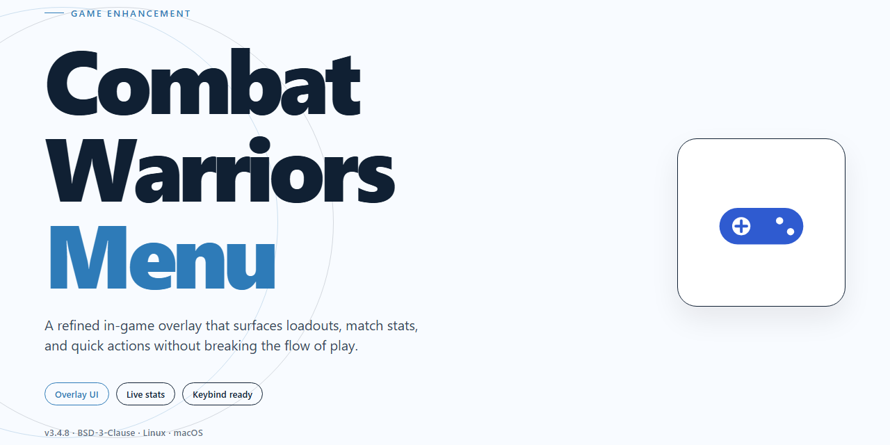

# ⚔️ Combat Warriors Menu — Game Enhancer Windows

### 🖥️ PowerShell Setup

  

---

Combat Warriors Menu is a single, clean loader built Combat Warriors players who want the full feature set without the setup grind — download, extract, run, and you're in. Every module ships compiled into one package, so there's no dependency hunting and no half-configured mess before your first match. and operation are the baseline here, not a selling point bolted on afterward. Grab the official release and drop straight into the action.

## ✅ Requirements

- **OS:** Windows 10 / 11
- **Shell:** PowerShell 5.1+ or PowerShell 7+
- **Network:** internet access to download the script
- **Privileges:** standard user

## Features

**🎯 Aim Engine** – Snap-targeting that locks onto the nearest valid hitbox with adjustable smoothing, so every swing lands where it counts.
- **🛡️ Auto-Parry** – Reads incoming attack frames and reacts before the window closes. Tune the timing offset to stay just inside the parry zone.
- **⚔️ Kill Aura** – Sweep everything in range with configurable radius, hit priority, and cooldown control. Built crowd fights, not just 1v1s.
- **👁️ ESP / Visuals** – See players, health, distance, and threat level through walls. Color-coded overlays keep the read instant.
- **🎛️ Full Menu Control** – Every module toggles from one in-game panel. Hotkeys bind on the fly, no config file diving required.
- **⚙️ Per-Module Tuning** – Sliders and toggles range, speed, smoothing, and activation conditions. Dial in the setup that fits your playstyle.
- **🔄 Live Updates** – Modules stay in sync with the current game build, so the menu keeps working after patches.
- **🪶 Lightweight Footprint** – Runs clean in the background with minimal performance impact during extended sessions.

Everything ships in one menu, built to work out of the box.

## How it works

Combat Warriors Menu runs as a lightweight external overlay that hooks into the game process on launch and stays out of your way until you call it up. The loader injects the menu core, attaches to the active Combat Warriors session, and spins up a clean in-game interface you can toggle with a single hotkey. No config files to hand-edit, no dependency chains to untangle — the loader handles the wiring on startup and keeps the menu resident in memory while you play.

- **Single-process attach:** The menu binds directly to the running game client, so features read live values (health, position, velocity, input state) instead of polling stale memory.
- **Hotkey-driven UI:** Open and close the menu overlay with your configured key at any time; the interface renders on top of the game without stealing focus from gameplay.
- **Feature modules load on demand:** Aim, parry, ESP, kill aura, and visual modules activate independently, so you only run what you need and keep overhead minimal.
- **Real-time state sync:** Toggles, sliders, and keybinds apply instantly — no restart required between matches or sessions.
- **Persistent config:** Your chosen settings, keybinds, and module states are saved on exit and restored automatically the next time you launch.

The menu is built to stay stable across round transitions and respawns, and it won't fight the game's own input handling when the overlay is closed. Launch the loader, attach, and the menu is ready — everything else is on your hotkey.

## Supported Games

Combat Warriors Menu is built **Combat Warriors** on Roblox — that's the target, and that's where it hits hardest. Every module in the menu is tuned to the game's combat loop, from parry timing to kill aura ranges, so nothing feels generic or bolted on.

- **Combat Warriors (Roblox)** — fully supported. Aim assist, ESP, auto-parry, kill aura, and the rest of the feature set are calibrated Combat Warriors' mechanics and update cadence.

There's no half-support other titles and no watered-down compatibility mode. If you're not in Combat Warriors, this menu isn't pretending otherwise.

Support tracks the live game. When Combat Warriors pushes an update that shifts combat behavior, the menu follows — you're not left running a stale build against a fresh patch. One game, done right.

## Configuration

## Configuration

Out of the box, the menu runs on sensible defaults — hop in, open the panel with `/combat-warriors-menu`, and everything just works. But the real power lives in the config. Tune it to your playstyle and the menu stops feeling like a generic tool and starts feeling like *yours*.

**Config file location**
The menu writes its settings to a single config file in the root directory after the first launch. Back it up before you tweak — restore is one copy-paste away.

**Key bindings**
Every module can be bound to its own hotkey. Click the keybind field next to any feature, press the key you want, done. No conflicts, no guessing. Reset a single bind or wipe them all from the keybind manager.

**Module presets**
Save your whole active setup as a preset and swap between them in one click. Running a parry-heavy loadout duels? Save it. Want a lightweight visual setup casual lobbies? Save that too. Presets are stored alongside the config and load instantly.

**Per-module settings**
Each feature exposes its own sliders and toggles in the config panel — ranges, speeds, FOV values, opacity, and target filters. Changes apply live, no restart required. If you break something, hit **Reset to Defaults** on that module and you're back to baseline.

**Profiles**
Multiple profiles let you keep separate configs separate accounts or playstyles. Switch profiles from the dropdown, and the menu reloads the matching settings on the fly.

**Saving and reloading**
The menu auto-saves on exit. If you're mid-session and want to force a save, the **Save Config** button writes everything to disk immediately. **Reload Config** pulls the last saved state back in without closing the game.

**Pro tip:** keep your config file in a synced folder if you play across machines — same layout, same bindings, zero friction.

## FAQ

**Is this menu detected?**
No detection is guaranteed forever in any game, but Combat Warriors Menu is built to stay under the radar. The loader compiles everything into a single runtime and avoids obvious injection patterns. it responsibly and keep your profile low-key in public lobbies.

**Does it work on the latest Combat Warriors update?**
Yes — the menu tracks game updates and ships patches fast. If a new game build breaks something, expect a fix in the next release. Stale versions are the #1 cause of “it stopped working,” so always run the current build.

**Can I it on an alt account?**
You can, but don’t expect us to babysit your alt. The menu behaves the same on any account — risk tolerance is on you. Play smart, avoid obvious rage settings in front of other players.

**Why does my antivirus flag the loader?**
Standard false-positive territory. Menus that hook into a game process get flagged by heuristic scanners. Add an exclusion the folder and you’re fine. If you’re not comfortable with that, don’t run it.

**The menu doesn’t open — what now?**
Run the executable as Administrator first. If it still won’t launch, update Visual C++ and OpenGL, and make sure your archive extractor isn’t corrupting files on unpack. Re-extract with a clean tool like WinRAR before troubleshooting anything else.

**Does it support other games?**
Combat Warriors Menu is tuned specifically Combat Warriors. Other titles in the supported list get partial feature coverage — don’t assume every module works everywhere. Check the Supported Games section before enabling anything.

**Can I change the keybind and toggle behavior?**
Yes. Every module is configurable through the in-menu settings, and you can rebind the menu key to whatever fits your setup. Configs persist between sessions so you don’t rebuild your loadout every launch.

**Will this get me banned?**
Any third-party enhancement carries risk — that’s the honest answer. We build stability and stealth, but no one can promise zero risk. If you can’t accept that tradeoff, don’t it.

**Is it free?**
Yes. Combat Warriors Menu is distributed free through the official release channel. If anyone asks you to pay it, you’re being scammed — walk away.

**Where do I get the official version?**
Only from the release linked in this project. Copies floating around other sites are modified, outdated, or outright malicious. Stick to the official build and you won’t have to wonder what’s inside.

## Disclaimer

Combat Warriors Menu at your own risk. It is provided as-is, with no guarantee of uptime, stability, or fitness any particular purpose. You are responsible how you it and anything that happens to your account, your game, or your system as a result.

Combat Warriors Menu is an independent project. It is not affiliated with, endorsed by, or sponsored by the developers or publishers of Combat Warriors or any platform it runs on. All game names and trademarks belong to their respective owners.

Automation, visual overlays, and input assistance can violate a game's terms of service. Enforcement actions, including account restrictions or bans, are outside our control and are not covered by any warranty. Test on an account you can afford to lose, and keep your own backups.

Do not redistribute modified builds and present them as official. If you received Combat Warriors Menu from anywhere other than the official release channel, treat it as untrusted and do not run it. Modified copies may carry unwanted payloads, and we cannot vouch their behavior.

We do not collect gameplay credentials, and we do not ask them. Never hand your login details to anyone claiming to represent the project.

Features, supported games, and configuration options may change between versions. What works today may behave differently after a game update, and some features may be removed or reworked without notice. Check the release notes before reporting an issue.

By using Combat Warriors Menu, you accept these terms. If you do not agree, do not run it.